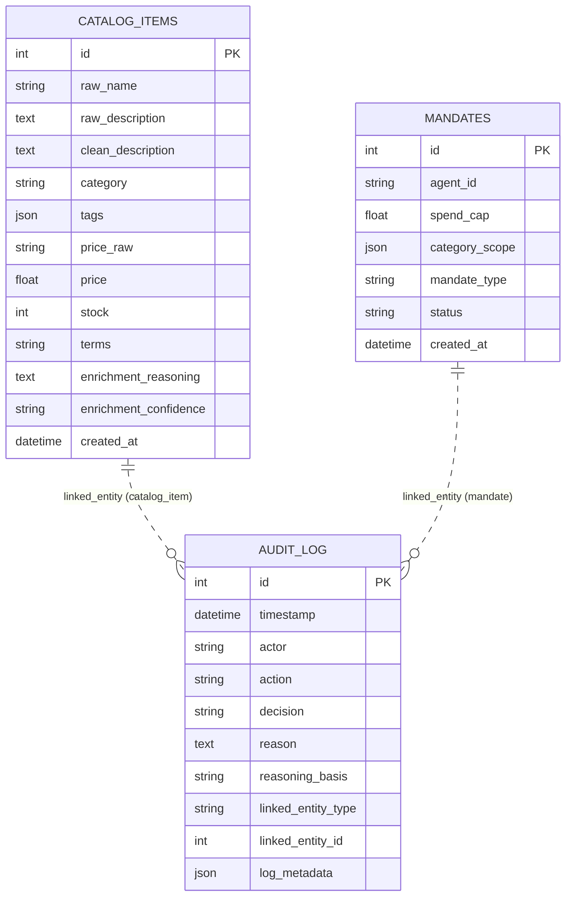

# Time & Co. — AI-Readiness Layer for Merchants


A merchant-side API that makes a small shop transactable by AI buyer agents. A messy raw product catalog is enriched once by an LLM into structured data; agents then browse it, negotiate within hard-coded guardrails, and pay through Razorpay (test mode) under a merchant-set spend mandate. Every decision lands in an audit log shown on a live dashboard.

- **Catalog** — LLM-enriched descriptions, categories, tags and prices, stored in SQLite and served without per-request LLM calls.
- **Negotiation** — discounts are decided by deterministic rules (≤5% off, order ≥ ₹10,000). The LLM only explains the decision.
- **Mandate** — a spend cap and category scope checked server-side *before* any Razorpay order is created.
- **Audit log** — every enrichment, negotiation, mandate check and payment, rendered on `/`.

## Data model

Three tables in `models.py`. There are no database foreign keys; the dotted links are logical references resolved by the app (`AuditLog.linked_entity_*` is a polymorphic pointer to a catalog item or a mandate).



## Setup

Requires Python 3.14, a [Gemini API key](https://aistudio.google.com/) and a Razorpay **test-mode** key pair.

```bash
python3 -m venv .venv && source .venv/bin/activate
pip install -r requirements.txt
cp .env.example .env        # then fill in the keys
python seed.py              # 15 raw SKUs + 1 mandate (safe to re-run)
python run_enrichment.py    # one-time LLM enrichment pass
uvicorn main:app --reload   # API + dashboard at http://localhost:8000
```

In a second terminal, run the sample buyer agent:

```bash
python demo_agent.py --happy      # or --failure, or a free-text request
```

When a run reaches payment, a checkout link opens in your browser. Pay with a Razorpay test card (e.g. `4100 2800 0000 1007`, any future expiry/CVV, any 4–10 digit OTP).

Run the guardrail logic check with `python test_negotiate_logic.py`.

## Configuration

| Variable | Required | Purpose |
|---|---|---|
| `GEMINI_API_KEY` | yes | Enrichment, negotiation explanations, agent |
| `RAZORPAY_KEY_ID` / `RAZORPAY_KEY_SECRET` | yes | Razorpay order creation (use test keys) |
| `API_KEY` | recommended | When set, `POST /negotiate` and `POST /payment` require an `X-API-Key` header |
| `DB_PATH` | no | SQLite file location (default `data/store.db`) |
| `LOG_LEVEL` | no | Python log level (default `INFO`) |
| `API_BASE_URL` | no | Where `demo_agent.py` finds the API (default `http://localhost:8000`) |

## API

| Method | Path | Auth | Purpose |
|---|---|---|---|
| `GET` | `/` | – | Live AI Activity dashboard |
| `GET` | `/health` | – | Liveness/readiness probe (checks the DB) |
| `GET` | `/catalog` | – | Enriched catalog |
| `POST` | `/negotiate` | `X-API-Key` | Propose quantity + discount; returns approved/blocked, final price, reason |
| `POST` | `/payment` | `X-API-Key` | Mandate check, then Razorpay order; held open until Checkout completes |
| `GET` | `/audit-log` | – | Full decision timeline |

## Deployment

**Docker**

```bash
docker build -t time-and-co .
docker run -p 8000:8000 --env-file .env -v time-and-co-data:/app/data time-and-co
```

The container seeds an empty database on start, runs as a non-root user, persists SQLite on the `/app/data` volume, and exposes a `HEALTHCHECK` against `/health`. The seed loads `data/seed_data.json`, a pre-enriched catalog snapshot, so no enrichment run is needed.

**PaaS (Render, Railway, Heroku, …)** — `render.yaml` (Render blueprint) and the `Procfile` are ready; set the env vars above, set `API_KEY`, and use `/health` as the health-check path.

**CI** — `.github/workflows/ci.yml` installs dependencies, runs the guardrail check and smoke-imports the app on every push.

## Project layout

```
main.py             FastAPI routes
models.py           SQLAlchemy schema
negotiate.py        Deterministic discount rules + LLM explanation
payment.py          Mandate checks and Razorpay wrapper
checkout.py         Human-in-the-loop Checkout flow (Razorpay needs a human step)
audit.py            Audit-log writer
llm.py              Gemini client with retry and model fallback
enrich.py           Per-item LLM enrichment
seed.py / run_enrichment.py   One-time data setup
demo_agent.py / console_ui.py  Sample buyer agent and its terminal UI
static/dashboard.html          Merchant dashboard
storefront/                    Static storefront page
```

## Limitations

- Test-mode payments only; Razorpay requires a human to complete Checkout, so payment confirmation is polled rather than webhook-driven.
- One mandate is a single-transaction cap, not a running balance.
- Single merchant, single mandate, SQLite storage. Scaling past one instance would mean swapping SQLite for a server database in `models.py`.
- `/catalog`, `/audit-log` and the dashboard are public; put them behind your proxy's auth if the data is sensitive.
